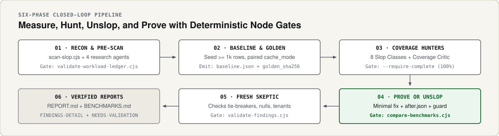

<p align="center">
  
</p>

<h1 align="center">unslop-backend</h1>

<p align="center"><sub>
  <b>English</b> ·
  <a href="i18n/README.zh-CN.md">简体中文</a> ·
  <a href="i18n/README.ja.md">日本語</a> ·
  <a href="i18n/README.ko.md">한국어</a> ·
  <a href="i18n/README.tr.md">Türkçe</a> ·
  <a href="i18n/README.es.md">Español</a> ·
  <a href="i18n/README.fr.md">Français</a> ·
  <a href="i18n/README.de.md">Deutsch</a> ·
  <a href="i18n/README.pt-BR.md">Português</a> ·
  <a href="i18n/README.vi.md">Tiếng Việt</a> ·
  <a href="i18n/README.ru.md">Русский</a>
</sub></p>

<p align="center">
  <b>Stop vibecoded backends from shipping 200-query N+1 loops and full table scans.</b><br>
  An agent skill that profiles, fixes, and proves SQL, ORM, and API speedups with paired benchmarks and exact golden SHA-256 parity.
</p>

<p align="center">
  <a href="https://github.com/Treamyracle/unslop-backend/actions/workflows/ci.yml"></a>
  
  
  <a href="LICENSE"></a>
</p>

<p align="center">
  <a href="#install"><b>Install</b></a> ·
  <a href="#use">Use</a> ·
  <a href="#proof-not-vibes">Proof</a> ·
  <a href="#real-open-source-case-study-louislamuptime-kuma-948k">Case Study</a> ·
  <a href="#what-it-catches">What It Catches</a> ·
  <a href="#how-it-works">How It Works</a> ·
  <a href="#what-this-does-not-do">Limits</a> ·
  <a href="#status--verification">Status</a>
</p>

Coding agents build working endpoints fast, and local tests usually seed five rows. A 214-query N+1 cascade, an unindexed join table, or an in-memory `SELECT *` aggregation looks instant on a laptop until real traffic hits. Asking an agent to "optimize this" makes one unmeasured guess, ships placebo rewrites, or silently breaks sort order and nullable fields.

**unslop-backend** measures first in your existing stack (Node/TypeScript, Python, Go, Ruby, SQL). It records baseline query counts, rows scanned, `EXPLAIN` plans, p95 latency, and a canonical `golden_sha256` at realistic local scale (`>= 1,000` rows), fixes one bottleneck at a time (or stays strictly read-only in Audit mode), and hard-fails any patch whose output drifts or whose speedup fails to clear the noise floor.

<table>
  <tr>
    <td width="25%" valign="top">
      <b>Map</b><br>
      <a href="skills/unslop-backend/scan-slop.cjs"><code>scan-slop.cjs</code></a> and 4 parallel research passes map routes, ORM calls, schema indexes, and exports into a validated <code>workload-ledger.json</code>.
    </td>
    <td width="25%" valign="top">
      <b>Baseline</b><br>
      Seeds <code>&gt;= 1,000</code> local rows, warms pools, and records <code>queries_per_req</code>, <code>rows_scanned</code>, <code>EXPLAIN</code>, <code>p95_ms</code>, and <code>golden_sha256</code>.
    </td>
    <td width="25%" valign="top">
      <b>Unslop</b><br>
      Applies one minimal fix per unit across 8 backend slop classes (or writes a read-only audit report) plus a regression guard test.
    </td>
    <td width="25%" valign="top">
      <b>Prove</b><br>
      <a href="skills/unslop-backend/compare-benchmarks.cjs"><code>compare-benchmarks.cjs</code></a> and a Fresh Skeptic pass verify parity. SHA-256 drift, <code>cache_mode</code> mismatch, or sub-noise gains exit <code>1</code>.
    </td>
  </tr>
</table>

<p align="center">
  
  <br>
  <sub>Measured locally on real on-disk <code>node:sqlite</code> with zero mocks. Reproduce in 2 seconds via <code>npm run test:benchmarks</code>.</sub>
</p>

---

## Install

Requires only your local coding agent and Node.js `>= 22.5` (zero runtime npm dependencies):

```bash
# Universal Skills CLI (Claude Code, Codex, Cursor, Antigravity, Gemini CLI, OpenCode)
npx skills add https://github.com/Treamyracle/unslop-backend --skill unslop-backend

# Or install globally across projects
npx skills add https://github.com/Treamyracle/unslop-backend --skill unslop-backend --global
```

<details>
<summary><b>Native Plugin, Extension &amp; Standalone CLI Installs (Claude Code, Gemini CLI, Codex, Cursor, Antigravity)</b></summary>

```bash
# Claude Code marketplace install (.claude-plugin/)
claude plugin install unslop-backend --marketplace Treamyracle/unslop-backend

# Gemini CLI extension (gemini-extension.json)
gemini extensions install https://github.com/Treamyracle/unslop-backend

# Google Antigravity / Cursor / Codex / Open Agents
git clone https://github.com/Treamyracle/unslop-backend.git
cp -r unslop-backend/skills/unslop-backend ~/.agents/skills/

# Standalone static pre-scanner directly on any backend folder (no plugin install needed):
node unslop-backend/skills/unslop-backend/scan-slop.cjs ./src --json
```

</details>

---

## Use

Ask in plain English; the matching mode engages automatically:

| Say | Mode | What happens |
|---|---|---|
| `"Check whether our Prisma/SQLAlchemy orders repo is doing in-app aggregation"` | **Guidance** | Read-only Q&A grounded in the 6 stack playbooks; edits nothing. |
| `"Audit ./src for N+1 queries, missing indexes, SELECT * bloat, and async waterfalls"` | **Audit** | Runs full 6-phase read-only reconnaissance, baseline measurement, and writes `REPORT.md`; edits zero source files. |
| `"Measure baseline query counts and unslop ./src/api without changing API output"` | **Unslop** | Applies branch-isolated fixes gated on paired `baseline.json` vs `after.json`, `golden_sha256`, regression guard tests, and Fresh Skeptic review. |

---

## Proof, not vibes

Most performance prompts stop as soon as the edited code still compiles. `unslop-backend` locks every optimization behind deterministic Node CLI gates (`exit 1` on any violation). Here is real output from [`compare-benchmarks.cjs`](skills/unslop-backend/compare-benchmarks.cjs) on the [`louislam/uptime-kuma`](examples/case-studies/uptime-kuma/README.md) reproduction:

```text
Paired Benchmark Gate: **PASS** (`cache_mode=warm`, `dataset_rows=25000`)

| Workload | Queries (Before → After) | Rows Scanned | Internal / Payload Bytes | p95 Latency | Golden Parity | Gate |
|---|---:|---:|---:|---:|---|---|
| `uptime-kuma-status-page-data` | 214 → 7 (-96.7%) | 315554 → 915 (-99.7%) | 374202B int → 185814B int (-50.3%) | 50.70ms → 3.67ms (-92.8%) | MATCH (SHA-256) | PASS |
| `uptime-kuma-rss-page-data` | 314 → 8 (-97.5%) | 315654 → 1115 (-99.7%) | 385352B int → 192107B int (-50.1%) | 54.82ms → 3.44ms (-93.7%) | MATCH (SHA-256) | PASS |
```

### How the deterministic gates stop an agent from cheating

| Failure Condition | What the Gate Catches | Enforcement |
|---|---|---|
| **Output contract drift** | Dropped nullable keys, shifted sort tie-breakers, changed aggregate precision, or reordered export IDs (`golden_sha256 DRIFT` / `row_ids_sha256`) | [`compare-benchmarks.cjs`](skills/unslop-backend/compare-benchmarks.cjs) exits `1` |
| **Unfair before/after pairing** | Cold baseline vs warm after (`cache_mode` mismatch) or fewer seeded rows after the edit (`dataset_rows` mismatch) | [`compare-benchmarks.cjs`](skills/unslop-backend/compare-benchmarks.cjs) exits `1` |
| **Placebo speedup or hidden regression** | Failing to clear the noise floor (`>= 50%` query/scan drop, `>= 30%` payload/heap drop, or `>= 20%` p95 drop) or regressing any counter `> 15%` | [`compare-benchmarks.cjs`](skills/unslop-backend/compare-benchmarks.cjs) exits `1` |
| **Speculative or hallucinated line cites** | Out-of-bounds `source_trace` lines, missing ledger unit coverage (`--require-complete`), or non-null severity on an unexecuted lead | [`validate-findings.cjs`](skills/unslop-backend/validate-findings.cjs) exits `1` (enforces `needs_validation` + `severity: null`) |

---

## Real Open-Source Case Study: `louislam/uptime-kuma` (`94.8k★`)

To verify `unslop-backend` on real production open-source code rather than toy examples alone, we audited [`louislam/uptime-kuma`](https://github.com/louislam/uptime-kuma) at commit [`1cc2fa7`](https://github.com/louislam/uptime-kuma/tree/1cc2fa7b1c9ec2be8e610167c8208309283177f2) and built a zero-dependency real SQLite (`node:sqlite`) reproduction using its exact upstream schema (`db/knex_init_db.js`) and exact SQL queries (`server/model/status_page.js`, `group.js`, `monitor.js`).

- **What `unslop-backend` found:** A **3-level nested SQL N+1 cascade** (`getStatusPageData` → `Group.getMonitorList` → `Monitor.getTags` & `Monitor.getCertExpiry`, plus `getRSSPageData` heartbeat loop) where `monitor_tag(monitor_id)` and `monitor_tls_info(monitor_id)` had **zero indexes**, forcing full table scans (`SCAN mt`, `SCAN monitor_tls_info`) for every monitor while `SELECT monitor.*` overfetched wide config columns.
- **Reproduce locally on real on-disk SQLite in 2 seconds:**

```bash
node examples/case-studies/uptime-kuma/reproduce.cjs
```

| Upstream Workload (`10` groups, `100` monitors, `25,000` heartbeats) | Queries (Before → After) | Rows Examined | Uninstrumented p95 | Golden Parity |
|---|---:|---:|---:|---|
| [`StatusPage.getStatusPageData`](examples/case-studies/uptime-kuma/README.md) | `214 → 7 (-96.7%)` | `315,554 → 915 (-99.7%)` | `50.70 ms → 3.67 ms (-92.8%)` | `MATCH (SHA-256)` |
| [`StatusPage.getRSSPageData`](examples/case-studies/uptime-kuma/README.md) | `314 → 8 (-97.5%)` | `315,654 → 1,115 (-99.7%)` | `54.82 ms → 3.44 ms (-93.7%)` | `MATCH (SHA-256)` |

```diff
# Actual SQLite EXPLAIN QUERY PLAN transition (StatusPage.getStatusPageData + getRSSPageData)
- SCAN incident / SCAN maintenance_status_page / SCAN group / SCAN monitor_group / SCAN mt (x100) / SCAN monitor_tls_info (x100) / USE TEMP B-TREE FOR ORDER BY
+ SEARCH incident USING INDEX idx_incident_status_pin_active
+ SEARCH maintenance_status_page USING COVERING INDEX idx_maintenance_sp
+ SEARCH group USING INDEX idx_group_status_page_public_weight
+ SEARCH mg USING INDEX idx_monitor_group_group_weight
+ SEARCH mt USING INDEX idx_monitor_tag_monitor        (batched WHERE IN)
+ SEARCH monitor_tls_info USING INDEX idx_monitor_tls_info_monitor
+ SEARCH h2 USING COVERING INDEX monitor_time_index    (correlated single-seek per monitor)
```

> **Scope & timing honesty:** Upstream [`status-page-router.js`](https://github.com/louislam/uptime-kuma/blob/1cc2fa7b1c9ec2be8e610167c8208309283177f2/server/routers/status-page-router.js#L16-L60) wraps these routes in 5-minute `apicache`, so this 214/314-query cascade fires on cache misses, cold starts, and post-edit invalidation (on fresh v2 schemas built by `db/knex_init_db.js`). Wall-clock p95 is timed on an uninstrumented pass completely separated from `EXPLAIN`, serialization byte-counting, and `stmt.stat("fullscanStep")` / `rowid` scan capture. Full breakdown: [`examples/case-studies/uptime-kuma/README.md`](examples/case-studies/uptime-kuma/README.md).

---

## What It Catches

Every finding and unit coverage check maps to one of the 8 canonical classes in [`SLOP-CLASSES.md`](skills/unslop-backend/SLOP-CLASSES.md):

| Slop Class | Pattern in Vibecoded Backends | Measured Signal |
|---|---|---|
| `n_plus_one_cascade` | ORM lazy-loads, `findOne`, or internal RPCs inside `for` / `.map()` loops | `queries_per_req` scales `O(N)` with list size |
| `missing_or_broken_index` | Missing composite indexes, wrong leading columns, `LOWER(col)` predicates, deep `OFFSET` | `EXPLAIN` shows `Seq Scan` / `SCAN` with `rows_scanned >> rows_returned` |
| `overfetch_and_payload_bloat` | `SELECT *` / unbounded `.findMany()` pulling wide JSON/TEXT columns only to discard them | Spiking `internal_bytes_read` or HTTP `payload_bytes` |
| `in_app_aggregation` | Pulling thousands of rows into JS/Python/Go memory to `.filter()`, `.sort()`, `.length`, or `reduce` | `rows_scanned` scales with full table size for small KPI/top-K output |
| `async_waterfall` | Sequential `await` chains across independent DB/HTTP/disk calls or duplicate per-request reads | `p95_ms` tracks sum of I/O legs instead of `max(...)` |
| `connection_and_tx_bloat` | Per-request DB/HTTP clients instead of pools, or holding SQL transactions open across LLM/HTTP I/O | Handshake spikes or long `idle in transaction` stalls |
| `memory_and_stream_slop` | Buffering multi-MB exports in RAM, `JSON.parse(JSON.stringify(...))` in loops, `readFileSync` on hot paths | High `heap_delta_kb`, event-loop pauses, unbounded RSS growth |
| `cold_start_and_bundle_slop` | Monolithic SDK barrel imports or eager client initialization at serverless/CLI module top level | Elevated cold-start `p95_ms` (`cache_mode: "cold"`) before first byte |

---

## How It Works

<p align="center">
  
</p>

1. **Reconnaissance & Pre-Scan ([`RECONNAISSANCE.md`](skills/unslop-backend/RECONNAISSANCE.md)):** Optionally seed candidate leads with [`scan-slop.cjs`](skills/unslop-backend/scan-slop.cjs), then run 4 parallel `research` agents across entrypoints, schemas/indexes, background exports/AI loops, and local profiling hooks to build `architecture.md` and `workload-ledger.json` (validated via [`validate-workload-ledger.cjs`](skills/unslop-backend/validate-workload-ledger.cjs)).
2. **Baseline & Golden Capture ([`BASELINE-AND-GOLDEN.md`](skills/unslop-backend/BASELINE-AND-GOLDEN.md)):** Seed `>= 1,000` deterministic local rows, warm up pools, record `baseline.json`, and lock canonical `golden_sha256` snapshots.
3. **Coverage-Led Hunting ([`HUNTING.md`](skills/unslop-backend/HUNTING.md)):** Audit every unit across all 8 classes in [`SLOP-CLASSES.md`](skills/unslop-backend/SLOP-CLASSES.md) and pass a Coverage Critic check (`validate-workload-ledger.cjs --require-complete`).
4. **Prove or Unslop ([`VALIDATION-AND-REPORTING.md`](skills/unslop-backend/VALIDATION-AND-REPORTING.md)):** Audit mode records read-only evidence; Unslop mode applies one minimal behavior-preserving fix per surface on a working branch, adds a regression guard test, captures `after.json`, and enforces [`compare-benchmarks.cjs`](skills/unslop-backend/compare-benchmarks.cjs).
5. **Fresh Skeptic Verification:** An independent skeptic probes tie-breakers, `NULL`/soft-delete semantics, cross-tenant cache isolation, and index write amplification before [`validate-findings.cjs`](skills/unslop-backend/validate-findings.cjs) signs off `findings.json`.
6. **Target-Neutral Reports:** Emits `REPORT.md`, `BENCHMARKS.md`, `FINDINGS-DETAIL.md`, and `NEEDS-VALIDATION.md`.

### Strict Four-Verdict Contract

- **`fixed`** *(Unslop mode only)*: Paired `baseline` + `after` benchmarks pass [`compare-benchmarks.cjs`](skills/unslop-backend/compare-benchmarks.cjs), `golden_match: true`, `skeptic_attempted: true`, and regression guard test passes.
- **`confirmed`**: Source trace + executed baseline telemetry/plan proving the slop without modifying source (`skeptic_attempted: true`).
- **`needs_validation`**: Plausible slop path where local DB/benchmark execution was blocked — **`severity` forced to `null`**, paired with a `safe_verification_recipe`.
- **`rejected`**: Disproved lead or rejected rewrite (already bounded or write tax outweighs scan cost) with `severity: null`.

<details>
<summary><b>Sample Verified <code>fixed</code> Finding (<code>examples/sample-audit-output/findings.json</code>)</b></summary>

```json
{
  "finding_id": "UNSLOP-001",
  "unit_id": "orders-list",
  "slop_class": "n_plus_one_cascade",
  "verdict": "fixed",
  "severity": "critical",
  "title": "Eliminated 101-query SQLite N+1 cascade and 755k-row full scans on GET /api/orgs/:orgId/orders",
  "baseline_metrics": { "queries_per_req": 101, "rows_scanned": 755050, "internal_bytes_read": 178205, "p95_ms": 80.474 },
  "after_metrics": { "queries_per_req": 3, "rows_scanned": 220, "internal_bytes_read": 12946, "p95_ms": 1.925 },
  "golden_match": true,
  "skeptic_attempted": true,
  "regression_guard_test": "node --test examples/sloppy-saas-api/benchmarks/slop-proof.bench.test.cjs"
}
```

Inspect the full validated sample artifacts: [`REPORT.md`](examples/sample-audit-output/REPORT.md) · [`BENCHMARKS.md`](examples/sample-audit-output/BENCHMARKS.md) · [`FINDINGS-DETAIL.md`](examples/sample-audit-output/FINDINGS-DETAIL.md) · [`NEEDS-VALIDATION.md`](examples/sample-audit-output/NEEDS-VALIDATION.md).

</details>

---

## Try the Real SQLite CI Fixture

Alongside the `uptime-kuma` case study, this repository ships [`examples/sloppy-saas-api/`](examples/sloppy-saas-api/sloppy-server.js), a self-contained CI fixture backed by **real on-disk `node:sqlite`** (`5,000` orders, `500` users, `15,000` order items) and **real HTTP `.ndjson.gz` disk shard decompression (`zlib.gunzip`)** comparing [`sloppy-server.js`](examples/sloppy-saas-api/sloppy-server.js) vs [`unslopped-server.js`](examples/sloppy-saas-api/unslopped-server.js):

```bash
# 1. Run all 18 unit tests for the static scanner, ledger validator, benchmark comparator, and findings gate
npm run test:validators

# 2. Run BOTH real node:sqlite proof suites (sloppy-saas-api + louislam/uptime-kuma)
npm run test:benchmarks

# 3. Validate all sample audit artifacts and case-study snapshots end-to-end
npm run validate:sample

# 4. Run static lead pre-scanner directly on the sloppy server
node skills/unslop-backend/scan-slop.cjs examples/sloppy-saas-api/sloppy-server.js
```

| Fixture Workload | Queries (Before → After) | Rows Examined | Payload / Internal Bytes | Uninstrumented p95 | Parity Gate |
|---|---:|---:|---:|---:|---|
| `orders-list` | `101 → 3 (-97.0%)` | `755,050 → 220 (-100.0%)` | `178.2 KB → 12.9 KB int (-92.7%)` | `80.47 ms → 1.93 ms (-97.6%)` | `golden_sha256` MATCH |
| `org-dashboard` | `6 → 2 (-66.7%)` | `5,005 → 505 (-89.9%)` | `802.1 KB → 378 B int (-100.0%)` | `26.84 ms → 1.10 ms (-95.9%)` | `golden_sha256` MATCH |
| `order-enrichment` | `4 → 4` *(libuv parallel shards)* | `4 → 4` | `390 B → 390 B` | `57.20 ms → 26.45 ms (-53.8%)` | `golden_sha256` MATCH |
| `orders-export` | `1 → 1` *(SQL `LIMIT 200` + projection)* | `5,000 → 200 (-96.0%)` | `641.3 KB → 29.9 KB HTTP (-95.3%)` | `34.36 ms → 3.28 ms (-90.5%)` | `row_ids_sha256` MATCH |

---

## How It Compares

| Tool | Focus | How `unslop-backend` Differs |
|---|---|---|
| `heydamir/unslop`, `impeccable` | Visual UI slop (CSS, layout, copy) | Targets backend routes, SQL/ORM query plans, payloads, streams, and async waterfalls |
| `desloppify`, `anti-slop` | Code-style & naming lint rules | Leaves style alone; targets **runtime telemetry** (`queries_per_req`, `rows_scanned`, payload bytes, p95, heap) |
| `EL4CTEO/fast-anything` | Ports hot CPU functions to Rust | Keeps your backend language and stack intact while removing **I/O, SQL, ORM, and serialization waste** |
| `Treamyracle/chaos-audit-skill` | Concurrency & race-condition correctness | Fixes **measured speed, scan, and memory bloat** with paired benchmarks and canonical `golden_sha256` gates |

---

## What This Does Not Do

- **Does not ship PostgreSQL or MySQL:** Live `EXPLAIN (ANALYZE, BUFFERS)` execution uses the database running on your machine. When a local DB cannot be started safely, leads remain `needs_validation` with `severity: null` and a reproducible `safe_verification_recipe`.
- **Never touches production databases or paid live APIs:** Reconnaissance, seeding, and benchmarking run strictly against disposable local seeds and local replay mocks.
- **Does not rewrite variable names, coding style, or port algorithms to Rust:** Performance claims only count when backed by measured telemetry before and after.
- **Refuses unverified severity scores:** Any finding without executed evidence or parity proof cannot be marked `confirmed` or `fixed`.

---

## Supported Agents & Native Manifests

All platform manifests resolve to [`skills/unslop-backend/`](skills/unslop-backend/SKILL.md):

| Agent / Ecosystem | Manifest / Entrypoint | Install / Discovery |
|---|---|---|
| **Claude Code** | [`.claude-plugin/marketplace.json`](.claude-plugin/marketplace.json), [`.claude-plugin/plugin.json`](.claude-plugin/plugin.json) | `claude plugin install unslop-backend --marketplace Treamyracle/unslop-backend` |
| **OpenAI Codex** | [`.codex-plugin/plugin.json`](.codex-plugin/plugin.json), [`assets/icon.png`](assets/icon.png) | Native Codex plugin + `./skills/` |
| **Cursor** | [`.cursor-plugin/plugin.json`](.cursor-plugin/plugin.json), [`.cursor-plugin/marketplace.json`](.cursor-plugin/marketplace.json) | Native Cursor plugin + marketplace |
| **Google Antigravity** | [`plugin.json`](plugin.json), [`assets/logo.svg`](assets/logo.svg) | Native Antigravity plugin with starter prompts |
| **Gemini CLI** | [`gemini-extension.json`](gemini-extension.json) | `gemini extensions install https://github.com/Treamyracle/unslop-backend` |
| **Universal (`skills.sh` / OpenCode)** | [`.agents/plugins/marketplace.json`](.agents/plugins/marketplace.json), [`SKILL.md`](skills/unslop-backend/SKILL.md) | `npx skills add https://github.com/Treamyracle/unslop-backend --skill unslop-backend` |

---

## Skill Playbooks & Gate Scripts

<details>
<summary><b>All 12 Workflow &amp; Stack Playbooks + 4 Zero-Dependency Gate Scripts</b></summary>

| File | Purpose |
|---|---|
| [`SKILL.md`](skills/unslop-backend/SKILL.md) | Guidance / Audit / Unslop modes, execution safety, 6-phase workflow, and anti-patterns |
| [`RECONNAISSANCE.md`](skills/unslop-backend/RECONNAISSANCE.md) | Phase 1 pre-scan + 4 parallel `research` agents + `workload-ledger.json` |
| [`BASELINE-AND-GOLDEN.md`](skills/unslop-backend/BASELINE-AND-GOLDEN.md) | Phase 2 local seed scale, `cache_mode` parity, and canonical `golden_sha256` snapshots |
| [`HUNTING.md`](skills/unslop-backend/HUNTING.md) | Phase 3 unit-by-unit slop hunting and Coverage Critic pass |
| [`VALIDATION-AND-REPORTING.md`](skills/unslop-backend/VALIDATION-AND-REPORTING.md) | Phases 4 to 6 minimal fix rules, Fresh Skeptic checks, and report templates |
| [`SLOP-CLASSES.md`](skills/unslop-backend/SLOP-CLASSES.md) | Canonical taxonomy of the 8 backend slop classes |
| [`ORM-AND-N-PLUS-ONE.md`](skills/unslop-backend/ORM-AND-N-PLUS-ONE.md) | Prisma, Drizzle, TypeORM, SQLAlchemy, Django ORM, GORM, DataLoader patterns |
| [`SQL-INDEXES-AND-QUERY-PLANS.md`](skills/unslop-backend/SQL-INDEXES-AND-QUERY-PLANS.md) | PostgreSQL / MySQL / SQLite `EXPLAIN`, composite/partial indexes, keyset cursors |
| [`PAYLOADS-STREAMING-AND-SERIALIZATION.md`](skills/unslop-backend/PAYLOADS-STREAMING-AND-SERIALIZATION.md) | Explicit column projection, pagination bounds, DTO mapping without deep clones |
| [`ASYNC-WATERFALLS-AND-CACHING.md`](skills/unslop-backend/ASYNC-WATERFALLS-AND-CACHING.md) | `Promise.all` / `asyncio.gather`, concurrency caps, singleflight, tenant-safe LRU |
| [`MEMORY-STREAMS-AND-COLD-STARTS.md`](skills/unslop-backend/MEMORY-STREAMS-AND-COLD-STARTS.md) | Cursor streaming backpressure, sync I/O elimination, serverless cold-start trimming |
| [`AI-PIPELINE-AND-LLM-IO-SLOP.md`](skills/unslop-backend/AI-PIPELINE-AND-LLM-IO-SLOP.md) | Batch embeddings, releasing DB transactions before LLM I/O, local replay harnesses |
| [`scan-slop.cjs`](skills/unslop-backend/scan-slop.cjs) | Zero-dep static pre-scanner for JS/TS/Python/Go/Ruby/SQL ([tests](skills/unslop-backend/scan-slop.test.cjs)) |
| [`validate-workload-ledger.cjs`](skills/unslop-backend/validate-workload-ledger.cjs) | Zero-dep workload ledger & repo line-bound gate ([tests](skills/unslop-backend/validate-workload-ledger.test.cjs)) |
| [`compare-benchmarks.cjs`](skills/unslop-backend/compare-benchmarks.cjs) | Zero-dep paired benchmark & golden SHA-256 comparator ([tests](skills/unslop-backend/compare-benchmarks.test.cjs)) |
| [`validate-findings.cjs`](skills/unslop-backend/validate-findings.cjs) | Zero-dep findings cross-checker against ledger & benchmarks ([tests](skills/unslop-backend/validate-findings.test.cjs)) |

</details>

---

## Status & Verification

See [`docs/STATUS.md`](docs/STATUS.md) for the complete verification matrix:

- ✅ **18/18 unit tests** for the static scanner, ledger validator, benchmark comparator, and findings gate (`node --test`, zero external dependencies)
- ✅ **Real OSS case study (`louislam/uptime-kuma`)**: reproducible `node:sqlite` suite drops `214 → 7` queries (`-96.7%`) and `314 → 8` queries (`-97.5%`) with exact `golden_sha256` match
- ✅ **Real SQLite CI fixture (`sloppy-saas-api`)**: `101 → 3` queries, `755,050 → 220` (`orders-list`) & `5,005 → 505` (`org-dashboard`) rows examined, `-53.8%` real libuv `zlib.gunzip` HTTP waterfall p95, `-95.3%` export payload, exact `golden_sha256` / `row_ids_sha256` match
- ✅ **Cross-platform CI**: verified across `ubuntu-latest`, `macos-latest`, and `windows-latest` on Node `22` and `24` (6/6 matrix jobs)
- ⚠️ **Live Postgres/MySQL guard**: running live `EXPLAIN (ANALYZE, BUFFERS)` depends on a local DB instance on the target machine; when unavailable, leads remain `needs_validation` (`severity: null`).

---

## License

MIT — see [`LICENSE`](LICENSE).
