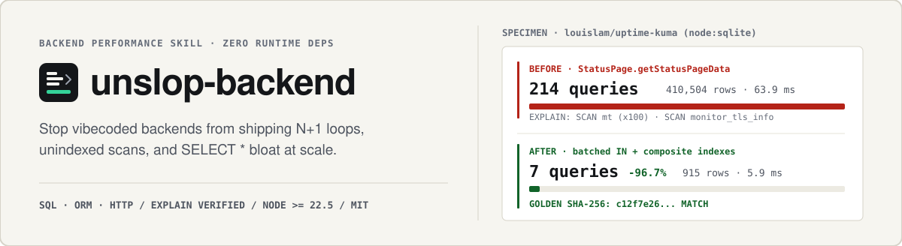
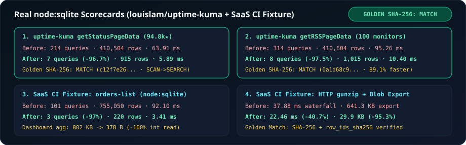

<p align="center">
  
</p>

<h1 align="center">unslop-backend (Deutsch)</h1>

<p align="center">
  <a href="../README.md">English</a> ·
  <a href="README.zh-CN.md">简体中文</a> ·
  <a href="README.ja.md">日本語</a> ·
  <a href="README.ko.md">한국어</a> ·
  <a href="README.tr.md">Türkçe</a> ·
  <a href="README.es.md">Español</a> ·
  <a href="README.fr.md">Français</a> ·
  <b>Deutsch</b> ·
  <a href="README.pt-BR.md">Português</a> ·
  <a href="README.vi.md">Tiếng Việt</a> ·
  <a href="README.ru.md">Русский</a>
</p>

<p align="center">
  <b>Dein Coding-Agent hat den Endpunkt in 10 Minuten gebaut. Hat er auch 101 SQL-Queries und 15 MB Full-Table-Scan pro Request eingebaut?</b><br>
  Ein messungsgeführter 6-Phasen-Skill für Claude Code, Codex, Cursor, Google Antigravity und Gemini CLI.<br>
  Jede Optimierung wird durch <b>gepaarte Vorher/Nachher-Telemetrie</b> und <b>exakte Golden-SHA-256-Parität</b> abgesichert.
</p>

<p align="center">
  
</p>

## Was erkannt und behoben wird
- **N+1-Abfragekaskaden (`n_plus_one_cascade`)** und **fehlende Indizes (`missing_or_broken_index`)**
- **`SELECT *`-Payload-Bloat (`overfetch_and_payload_bloat`)** und **In-App-Aggregation (`in_app_aggregation`)**
- **Sequentielle Async-Wasserfälle (`async_waterfall`)**, Verbindungs-/Transaktions-Bloat, Stream-Buffering und Cold-Start-Verzögerungen

## 6-Phasen-Workflow mit Zero-Dependency-Gates
1. Vorscan mit [`scan-slop.cjs`](../skills/unslop-backend/scan-slop.cjs) und Prüfung über [`validate-workload-ledger.cjs`](../skills/unslop-backend/validate-workload-ledger.cjs) ([`RECONNAISSANCE.md`](../skills/unslop-backend/RECONNAISSANCE.md)).
2. Lokale Baseline (`>= 1,000` Zeilen) und kanonischer `golden_sha256` ([`BASELINE-AND-GOLDEN.md`](../skills/unslop-backend/BASELINE-AND-GOLDEN.md)).
3. Abdeckungsgeführte Suche ([`HUNTING.md`](../skills/unslop-backend/HUNTING.md)) mit `--require-complete`.
4. Minimaler Fix und Gate über [`compare-benchmarks.cjs`](../skills/unslop-backend/compare-benchmarks.cjs).
5. Unabhängiger Skeptiker-Check + [`validate-findings.cjs`](../skills/unslop-backend/validate-findings.cjs).
6. Berichte: `REPORT.md`, `BENCHMARKS.md`, `FINDINGS-DETAIL.md` und `NEEDS-VALIDATION.md`.

## Echte Open-Source-Fallstudie: `louislam/uptime-kuma` (`94.8k★`)

Reale `node:sqlite`-Reproduktion des Upstream-Schemas und der Queries (`1cc2fa7`): senkt `getStatusPageData` von **`214 → 7` Queries (`-96.7%`)** und `getRSSPageData` von **`314 → 8` (`-97.5%`)** bei **exakter Golden-SHA-256-Parität** ([Fallstudie](../examples/case-studies/uptime-kuma/README.md)).

## Installation & Tests

```bash
npx skills add https://github.com/Treamyracle/unslop-backend --skill unslop-backend
npm test
node examples/case-studies/uptime-kuma/reproduce.cjs
```

Details im [englischen README](../README.md) und unter [`docs/STATUS.md`](../docs/STATUS.md) ([MIT-Lizenz](../LICENSE)).
